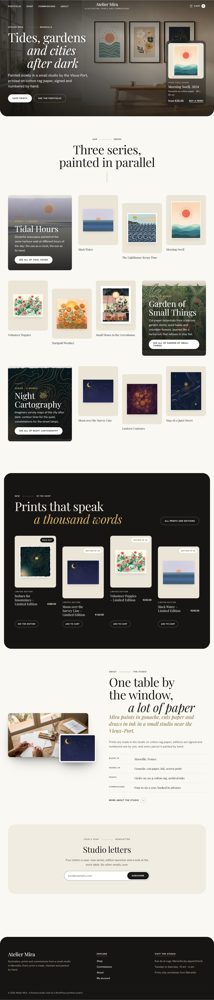

# Atelier Mira

A custom WordPress build for a (fictional) illustrator: a portfolio of artworks, a print shop on a **customised WooCommerce** with numbered limited editions, and a commission request form.

Everything is hand-written: a classic PHP theme (`atelier-mira`) and a business plugin (`mira-studio`). No page builder, no premium plugin, no ACF. WooCommerce is the only third-party plugin, and it is customised **with hooks and filters only: zero template overrides**.

[](https://playground.wordpress.net/?blueprint-url=https://raw.githubusercontent.com/mouradlhousni/boutique/master/blueprint.json)



## Live demo

**[Try the live demo in WordPress Playground](https://playground.wordpress.net/?blueprint-url=https://raw.githubusercontent.com/mouradlhousni/boutique/master/blueprint.json)**: a full WordPress runs in your browser, nothing is hosted. The [`blueprint.json`](blueprint.json) installs WooCommerce, the theme and the plugin from this repository, enables `MIRA_DEMO_MODE`, runs `wp mira seed`, logs you in as admin and opens the home page (allow about a minute for the first load).

In demo mode every feature can be tried, but forms validate without storing or sending anything, and checkout only accepts the "Cash on delivery" test gateway, with order emails switched off.

## Features

### Portfolio
- `artwork` post type (archive at `/portfolio/`) with year, technique, dimensions, a gallery and an optional link to the matching print; `artwork_series` taxonomy (`/series/<slug>/`).
- Masonry grid (CSS columns) **filterable by series without reloading**. The filters are real links to the series pages, so the grid works without JavaScript and in the static export. A small vanilla script turns them into in-page filters with history support, a live count for screen readers and an entrance animation that respects `prefers-reduced-motion`.
- Artwork pages with a museum-style wall label, gallery, "buy a print" link and a pager within the series.
- **"Artwork Series Showcase" block**: a dynamic block built with `@wordpress/scripts`. The editor sidebar picks the series, the number of works and whether to show descriptions; the editor preview is the real server render (`ServerSideRender`).

### Shop (WooCommerce)
- **Limited editions**: an "Edition size" field in its own product data tab (simple and variable products). The product page shows a "12 / 50 sold" counter. Every print sold gets a number ("Print #13/50") stored on the order line and shown in the admin, the emails, the thank-you page and My account. The product switches to **Sold out** automatically when the edition is complete.
  - Numbers follow WooCommerce's own stock movements: they are issued on `woocommerce_reduce_order_stock` and released on `woocommerce_restore_order_stock` (cancelled orders). Stock, "sold" and "sold out" therefore never disagree, and a released number is reissued first.
  - Issuing runs under an atomic per-product lock (`INSERT IGNORE` on a unique option row, which works on MySQL and on Playground's SQLite), so two simultaneous orders can never get the same number.
- **Variable prints**: format (A4, A3, A2) × frame (unframed / black oak), each with its own price. Format terms store their paper size in millimetres (editable on the attribute term screen).
- **Product page**: a gallery with zoom (follows the pointer, or the arrow keys from the zoom button) and thumbnails. The format and frame choices are **buttons** that drive WooCommerce's variation selects, so WooCommerce's own logic (price, stock, variation ID) is untouched. A **"to scale" preview** draws the chosen format, framed or not, in centimetres above a 2 m sofa (SVG).
- **Cart drawer**: a native `<dialog>` (focus trap, Escape, backdrop) holding the mini cart. It is updated through **WooCommerce cart fragments** returned by a vanilla `fetch()` add-to-cart endpoint, which replaces WooCommerce's jQuery `wc-add-to-cart` and `wc-cart-fragments` scripts.
- **Gift message** at checkout. On the classic checkout it uses hooks; on the block checkout it uses the Additional Checkout Fields API. It is stored in one order meta (HPOS-safe CRUD) and shown in the order admin, the emails (HTML and plain text), the thank-you page and My account.
- **HPOS compatibility declared** (plus cart/checkout blocks); orders are only touched through the `WC_Order` API. The dev site runs with HPOS enabled.
- Free shipping replaces the paid rate when it applies.

### Commissions
- Public form (`[mira_commission_form]`, used by the "Commissions" page template): project description, budget range, ideal deadline, up to three reference images, consent.
- **Security**: nonce, honeypot, a signed minimum fill time, a rate limit per client (IP kept only as a salted hash), and server-side validation of every field.
- **Uploads**: count and size limits, the **real MIME type** sniffed from the file content with a matching extension, decodable images with a dimension cap. Files are **re-encoded** (this drops metadata and anything appended to the image), renamed randomly and stored outside the media library in a folder closed to the web. They can only be downloaded from the admin, with a nonce and the `edit_post` capability, as `nosniff` attachments.
- Saved as a private `commission_request` post with the statuses **New → Quoted → Accepted / Declined**, managed from a custom status box (with quote amount and private note), list columns, status filters and a "new requests" counter in the menu.
- Emails: studio notification, client confirmation, and a client message when the request is quoted, accepted or declined.
- Progressive enhancement: with JavaScript the form posts with `fetch()` and shows errors next to the fields (with focus management). Without it, the form posts to its own page: errors are rendered in place and success follows Post/Redirect/Get.

### Seed command

```bash
wp mira seed               # 20 artworks, 3 series, 12 products (4 limited editions), 9 orders
wp mira seed --images=6    # fewer unique images (WordPress Playground)
```

All images are **painted locally with GD**: abstract seascapes, cut-paper botanicals and night maps, one visual language per series, plus framed "on the wall" mockups and detail crops, saved as **WebP**. Nothing is downloaded or hotlinked. The command also configures the store (EUR, Cash on delivery and Check payments, shipping, classic cart and checkout pages), creates the pages and menus, and places test orders through the real order flow (one edition sells out; a cancelled order releases its number). It is idempotent: a second run replaces exactly what the first one created.

**Your own images**: drop files named `hero`, `studio` and `artwork-01` … `artwork-20` (`.jpg`, `.png` or `.webp`) in [`plugins/mira-studio/assets/demo-images/`](plugins/mira-studio/assets/demo-images/README.md) and run the seed again. Each file found replaces the painted image (downscaled to 2400 px and saved as WebP); missing ones are still painted. Without a `hero` photo, the seed paints a gallery room with three of the artworks on the wall. Both home photos can also be changed in **Appearance → Customize → Home page**.

## Design

A warm, editorial gallery: the artworks bring the colour, the site stays quiet around them.

- **Type**: Playfair Display (a high-contrast serif) for titles, Hanken Grotesk for text, both self-hosted variable fonts. Titles often run on two lines, the second in italic and set off to the right; small uppercase eyebrows join two words with a gold rule ("New —— In the shop").
- **Palette**: warm white walls `#faf8f3`, a beige mat `#ebe5d8` behind every print, ink `#1a1917`, one ochre accent `#7a5f22` for links and accent text, gold `#b8913f` for rules and bars only, and a near-black `#161513` for the moments that need weight.
- **Shapes**: rounded artworks and cards, pill buttons and filters, a rounded night band for new prints, a rounded dark footer.
- **Home**: a full-bleed photo with the title in white and a "quick view" card of the featured print (the header floats over it until the page scrolls), the series as cards with their latest work in the background, new prints staggered on the night band, the studio with overlapping images, the newsletter in a single pill.
- **Contrast** (WCAG AA for all text): ochre 5.7:1 on the wall and 4.8:1 on the mat, secondary text 6.8:1, light text 15.9:1 and gold 8.6:1 on the night band.

## WooCommerce hooks used, and why

| Hook | Where | Why |
| --- | --- | --- |
| `before_woocommerce_init` | plugin | Declare HPOS and checkout blocks compatibility. |
| `woocommerce_product_data_tabs`, `woocommerce_product_data_panels`, `woocommerce_admin_process_product_object` | plugin | "Limited edition" tab; save the size and align managed stock with it. |
| `woocommerce_reduce_order_stock`, `woocommerce_restore_order_stock` | plugin | Issue / release print numbers exactly when WooCommerce moves the stock. |
| `woocommerce_order_item_get_formatted_meta_data` | plugin | "Print #13/50" wherever WooCommerce prints item meta (admin, emails, account). |
| `woocommerce_single_product_summary`, `woocommerce_before_shop_loop_item_title` | plugin | Edition counter; "Edition of 50" / "Sold out" badges. |
| `woocommerce_get_availability_text`, `woocommerce_get_item_data` | plugin | "Sold out – the edition is complete", "Only 3 prints left"; edition note in the cart. |
| `woocommerce_after_order_notes`, `woocommerce_after_checkout_validation`, `woocommerce_checkout_create_order` | plugin | Gift message on the classic checkout. |
| `woocommerce_init` (`woocommerce_register_additional_checkout_field`), `woocommerce_set_additional_field_value` | plugin | Gift message on the block checkout, mirrored into the same meta. |
| `woocommerce_admin_order_data_after_shipping_address`, `woocommerce_email_after_order_table`, `woocommerce_order_details_after_order_table` | plugin | Show the gift message to the studio and the customer. |
| `woocommerce_package_rates` | plugin | Free shipping replaces the paid rate when eligible. |
| `woocommerce_email_enabled_{id}` | plugin | Silence order emails while seeding (and in demo mode). |
| `woocommerce_enqueue_styles` | theme | Replace WooCommerce's stylesheets with the theme's own. |
| `woocommerce_before_main_content`, `woocommerce_after_main_content`, `woocommerce_breadcrumb_defaults` | theme | Theme wrappers and a quieter breadcrumb. |
| `woocommerce_archive_description` | theme | Shop intro and category filters. |
| `woocommerce_before_shop_loop_item_title`, `woocommerce_shop_loop_item_title`, `woocommerce_get_price_html`, `woocommerce_product_add_to_cart_text`, `woocommerce_product_add_to_cart_description` | theme | Card images on their mat with explicit `sizes`, a "Limited edition" / category line above the title, "from €35", clearer button labels whose accessible names match the visible text. |
| `woocommerce_before_single_product_summary`, `woocommerce_single_product_summary`, `woocommerce_after_single_product_summary` | theme | Gallery with zoom, scale preview, details section (instead of tabs). |
| `woocommerce_reset_variations_link`, `woocommerce_product_single_add_to_cart_text`, `woocommerce_output_related_products_args`, `woocommerce_product_related_products_heading` | theme | Button-driven variations, labels, three related prints. |
| `woocommerce_add_to_cart_fragments`, `wc_ajax_mira_add_to_cart`, `woocommerce_widget_shopping_cart_buttons` | theme | Cart drawer content and count as fragments; vanilla add-to-cart endpoint; drawer buttons. |
| `woocommerce_review_order_after_submit` | theme | Packing and numbering note under "Place order". |

## Performance

The site is very visual, so performance is part of the brief:

- **Images**: a trimmed size budget (core's 1536/2048 sizes are removed; `large` is 1200; WooCommerce sizes are uncropped so every size shares the image's ratio and lands in its `srcset`). Every template passes an explicit `sizes` attribute. Images are lazy-loaded except the **LCP image** (hero, artwork, product main image), which is `eager` with `fetchpriority="high"`. Generated images are WebP, and JPEG uploads get WebP sub-sizes.
- **CSS/JS**: one global stylesheet (25 KB minified), a 4 KB stylesheet for the header cart and its drawer (present on every page), a shop stylesheet only where WooCommerce renders, and page-specific **vanilla** scripts (no jQuery in the theme) loaded with `defer`. Fonts are self-hosted, preloaded and declared inline (`font-display: swap`).
- **WooCommerce assets**: its stylesheets are replaced; `wc-add-to-cart` and `wc-cart-fragments` are removed everywhere; the `woocommerce` script and order-attribution tracking only load on cart, checkout and account; block styles are dropped. jQuery (still needed by WooCommerce's variation and checkout scripts) moves to the footer, and `jquery-migrate` and `wc-single-product` are removed. Only product, cart, checkout and account pages load jQuery: the home page, shop, portfolio and content pages do not.
- **No layout shift**: the `js` class is set in `<head>`, so the CSS reserves the space of every enhancement (option buttons, gallery controls, variation price) from the first paint.

Lighthouse (mobile, simulated throttling), measured before the Phase 9 redesign (to be measured again) on the **dynamic** WordPress site in Laragon, with no page cache, gzip or cache headers (Laragon's Apache runs without `mod_deflate` / `mod_expires`):

| Page | Performance | Accessibility | Best practices | SEO |
| --- | --- | --- | --- | --- |
| Home | 97 | 100 | 100 | 100 |
| Portfolio | 97 | 100 | 100 | 100 |
| Shop | 97 | 100 | 100 | 100 |
| Product (variable print) | 90 | 100 | 100 | 100 |
| Product (limited edition) | 98 | 100 | 100 | 100 |
| Commissions | 99 | 100 | 100 | 100 |

The remaining product-page cost is server time (about 1 s TTFB for an uncached WooCommerce page on a local machine) and the missing compression and caching, which a production host or the static export provides.

## Accessibility

- Skip link, landmarks, visible focus everywhere, AA contrast for all text (see [Design](#design)).
- Filters are links with `aria-current`; the result count is announced (`role="status"`).
- Gallery: thumbnails are buttons with `aria-pressed`; the zoom is a toggle button that pans with the arrow keys and closes with Escape.
- Format choices are buttons with `aria-pressed` in labelled groups; the original selects stay in the form, hidden from assistive technology.
- The cart drawer is a modal `<dialog>`: focus moves into it, stays there, and Escape closes it.
- Form errors are tied to their fields (`aria-invalid`, `aria-describedby`), and the focus moves to the first one.
- Every animation is disabled under `prefers-reduced-motion`.

## Code quality

- PHP 8.1+, namespaces (`AtelierMira\Studio`), the `mira_` prefix for hooks, options and template functions, and `atelier_mira_` in the theme.
- `composer lint` runs **phpcs with the WordPress Coding Standards and PHPCompatibilityWP: no errors, no warnings**. `npm run lint:js` and `npm run lint:css` pass too.
- Security: every output is escaped, every input sanitized, nonces and capabilities on every write, uploads validated as described above.
- No notice with `WP_DEBUG` on the front end and in the admin screens.

## Installation

Requirements: PHP 8.1+ with GD, Node 20+, Composer, Docker (for `wp-env`).

```bash
composer install
npm install
npx wp-env start                   # WordPress + WooCommerce + theme + plugin
npx wp-env run cli wp mira seed    # demo content (≈ 1 minute)
```

Then open http://localhost:8888 (admin: `admin` / `password`).

Without Docker, use any local WordPress (LocalWP, Laragon…): copy or symlink `themes/atelier-mira` and `plugins/mira-studio`, install WooCommerce, activate both, set pretty permalinks, then run `wp mira seed`.

Build steps (outputs are committed, so the theme runs without them):

```bash
npm run build          # block (build/blocks) + minified CSS/JS
npm run vendor         # copy the self-hosted fonts from node_modules
npm run lint           # phpcs + eslint + stylelint
```

## Project structure

```
├── .wp-env.json, composer.json, phpcs.xml.dist, package.json
├── bin/                         # build-assets.js, copy-vendor.js
├── plugins/mira-studio/
│   ├── mira-studio.php          # bootstrap, autoloader, HPOS declaration
│   ├── includes/functions.php   # public template API used by the theme (mira_*)
│   ├── assets/demo-images/      # your own demo images (optional, see its README)
│   └── src/
│       ├── Portfolio/           # artwork CPT, series, meta box
│       ├── Shop/                # editions, gift message, formats, shipping
│       ├── Commissions/         # form, uploads, CPT + statuses, admin, emails, rate limit
│       └── Cli/                 # wp mira seed, GD image painter
└── themes/atelier-mira/
    ├── inc/                     # setup, images, assets, Customizer, WooCommerce hooks, blocks
    ├── blocks/series-showcase/  # block source (build/ holds the compiled version)
    ├── assets/                  # css, js (vanilla), fonts, images
    └── *.php                    # classic templates
```

## Screenshots

| | |
| --- | --- |
|  |  |
|  |  |
|  |  |

## License

GPL-2.0-or-later. Fonts: Playfair Display and Hanken Grotesk (SIL Open Font License, see `themes/atelier-mira/assets/fonts`).
